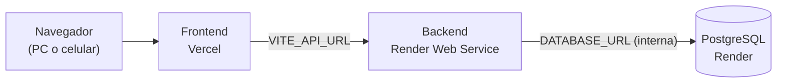

# 📍 GeoServi-App

Aplicación web para conectar **clientes** que necesitan un servicio del hogar (plomería, electricidad, cerrajería, etc.) con **prestadores** cercanos.

> **Equipo:** Luis Miguel Montalvo · Diego Bermúdez
> **Proyecto de grado:** ADSO – SENA
> **Última actualización:** 24 de octubre de 2026

---

## 📑 Índice

1. [Stack tecnológico](#1-stack-tecnológico)
2. [Arquitectura y despliegue](#2-arquitectura-y-despliegue)
3. [Estado actual](#3-estado-actual)
4. [Variables de entorno](#4-variables-de-entorno)
5. [Cómo correr el proyecto en local](#5-cómo-correr-el-proyecto-en-local)
6. [Flujo de trabajo con Git](#6-flujo-de-trabajo-con-git)
7. [Problemas encontrados y cómo se resolvieron](#7-problemas-encontrados-y-cómo-se-resolvieron)
8. [Pasos a seguir](#8-pasos-a-seguir)
9. [Decisiones pendientes](#9-decisiones-pendientes)
10. [Reglas de seguridad del proyecto](#10-reglas-de-seguridad-del-proyecto)

---

## 1. Stack tecnológico

| Capa | Tecnología |
|---|---|
| Frontend | React + Vite + Tailwind CSS |
| Backend | Node.js + Express 5 (módulos ES, `"type": "module"`) |
| Base de datos | PostgreSQL 18, con `pg` y SQL crudo (ADR-001) |
| Validación | Zod |
| Seguridad | bcrypt (costo 10), JWT de 1 h, helmet, express-rate-limit, cors |
| Despliegue | Vercel (frontend) · Render (backend y base de datos) |

---

## 2. Arquitectura y despliegue



| Servicio | Dirección | Región |
|---|---|---|
| Frontend | https://geoservi-app.vercel.app | — |
| Backend | https://geoservi-app-00tx.onrender.com | Oregon (US West) |
| Base de datos | `Geoservi-db` (solo accesible por la red interna de Render) | Oregon (US West) |

**Cómo se conecta todo**

- El frontend sabe dónde está el backend por la variable `VITE_API_URL`, que Vite escribe dentro del código **al construir**. Si se cambia, hay que hacer *Redeploy* en Vercel.
- El backend sabe dónde está la base por `DATABASE_URL` (la *Internal Database URL* de Render).
- El backend acepta peticiones solo del dominio del frontend gracias a `FRONTEND_URL` (CORS).

**Ramas que despliega cada servicio:** ambos publican `main`.

---

## 3. Estado actual

**Leyenda:** ✅ listo · 🟡 en curso o por verificar · ⬜ pendiente

| Elemento | Estado | Notas |
|---|---|---|
| Backend: `POST /auth/register`, `POST /auth/login`, `GET /auth/me` | ✅ | Probado en la nube (registro y login) |
| Backend: perfiles de prestador (`/providers/me`) | ✅ | Queda pendiente de aprobación del admin |
| Backend: publicar solicitud (`POST /requests`) y ver las mías (`GET /requests/mine`) | 🟡 | Está en la rama `feature/HU-02-publicar-solicitud`. **Falta probarlo, abrir el Pull Request con `Closes #3` y hacer el merge a `main`.** Mientras no esté en `main`, no existe en producción |
| Base de datos en Render con las 7 tablas | ✅ | `users`, `provider_profiles`, `service_requests`, `offers`, `ratings`, `payments`, `audit_logs` + migración `001_account_status` |
| Script de migraciones (`backend/scripts/migrate.js`) | ✅ | Ejecuta archivos `.sql` sin necesitar `psql` |
| Frontend: Tailwind CSS configurado | ✅ | |
| Frontend: `Login.jsx` con diseño nuevo | ✅ | En producción |
| Frontend: `Register.jsx` con diseño nuevo | ⬜ | **Nunca se commiteó.** En producción sigue el diseño viejo |
| Frontend: conexión al backend con `VITE_API_URL` | ✅ | Funciona desde PC y celular |
| Frontend: pantalla principal | 🟡 | Muestra una lista **fija** de oficios (Plomero, Electricista, Cerrajero, Jardinero) con el botón "Solicitar servicio (próximamente)". No usa datos reales |
| Despliegue: frontend en Vercel | ✅ | |
| Despliegue: backend y base en Render | ✅ | Verificar el Start Command (ver sección 8, fase A) |
| Administrador (`seed:admin`) | ⬜ | El script existe, falta ejecutarlo en la base nueva |
| "¿Olvidaste tu contraseña?" | ⬜ | No existe ni en frontend ni en backend |
| Saludo "Bienvenido: nombre" | ⬜ | Hoy muestra el correo |
| Radar de ondas con oficios | ⬜ | Hoy hay un radar con barrido giratorio |
| Mapa estático con prestadores y solicitudes | ⬜ | Diseñado, sin programar |
| Calificaciones en ambos sentidos | ⬜ | Decidido, sin documentar ni programar |
| Login con Google | ⬜ | Solo el botón (muestra "próximamente") |

---

## 4. Variables de entorno

> **Nunca** se escriben valores reales en este archivo ni en el repositorio. Solo los nombres.

### Backend (Render → Web Service → Environment)

| Variable | Qué es | De dónde sale |
|---|---|---|
| `DATABASE_URL` | Conexión a PostgreSQL | *Internal Database URL* de `Geoservi-db` (botón de copiar) |
| `JWT_SECRET` | Clave para firmar los tokens | Una cadena larga y aleatoria, distinta a la de local |
| `FRONTEND_URL` | Dominio permitido por CORS | `https://geoservi-app.vercel.app` (sin barra final) |
| `PORT` | Puerto del servidor | Lo asigna Render; en local cae en `4000` |

### Frontend (Vercel → Settings → Environment Variables)

| Variable | Qué es | Valor |
|---|---|---|
| `VITE_API_URL` | Dirección pública del backend | `https://geoservi-app-00tx.onrender.com` (sin barra final). Se guarda como **Config**, porque no es un secreto |

### Local

| Archivo | Contenido | ¿Se sube a GitHub? |
|---|---|---|
| `backend/.env` | `DATABASE_URL`, `JWT_SECRET`, `FRONTEND_URL`, `PORT` | **No** |
| `frontend/.env.local` | `VITE_API_URL=http://localhost:4000` | **No** |

---

## 5. Cómo correr el proyecto en local

### Backend

```powershell
cd backend
npm install

# Crear las tablas en una base local vacía (una sola vez)
node scripts/migrate.js src/db/schema.sql src/db/migrations/001_account_status.sql

npm run dev        # desarrollo con nodemon
```

### Frontend

```powershell
cd frontend
npm install
npm run dev        # normalmente en http://localhost:5173
```

El frontend lee `VITE_API_URL` al arrancar: si cambias `.env.local`, reinicia `npm run dev`.

### Scripts del backend

| Script | Qué hace |
|---|---|
| `npm run dev` | Servidor con recarga automática (**solo para desarrollo**) |
| `npm start` | Servidor de producción (`node src/server.js`) |
| `npm run seed:admin` | Crea el usuario administrador |

---

## 6. Flujo de trabajo con Git

GitHub Flow: **una rama y un Pull Request por tarea**, nunca mezclar temas.

```powershell
git checkout main
git pull origin main
git checkout -b feature/nombre-de-la-tarea

# ...trabajar...
git status -s                      # revisar qué cambió
git add ruta/del/archivo           # archivo por archivo, evitar "git add ."
git commit -m "feat(frontend): descripción corta"
git push -u origin feature/nombre-de-la-tarea
```

Después se abre el Pull Request en GitHub. Si el PR cierra una historia de usuario, la descripción lleva `Closes #n`.

| Prefijo de commit | Cuándo |
|---|---|
| `feat` | Funcionalidad nueva |
| `fix` | Corrección de un error |
| `chore` | Configuración, scripts, dependencias |
| `docs` | Documentación |

### Ramas existentes

| Rama | Estado |
|---|---|
| `main` | Producción. Vercel y Render publican esta rama |
| `feature/HU-02-publicar-solicitud` | En GitHub, pendiente de PR y merge |
| `feature/frontend-login` | Ya fusionada. Se puede borrar |

---

## 7. Problemas encontrados y cómo se resolvieron

Esta tabla sirve como evidencia del proceso para el proyecto de grado.

| # | Problema | Causa | Solución |
|---|---|---|---|
| 1 | Cambios de frontend mezclados en la rama de HU-02 | Los commits de Tailwind y login se hicieron sobre `feature/HU-02-publicar-solicitud` | `git cherry-pick` a `feature/frontend-login` desde `main`, y `git reset --hard origin/...` en la rama de HU-02 |
| 2 | Vercel mostraba el login viejo | Publicaba `main`, que aún no tenía el PR del login | Hacer el merge del Pull Request y esperar el nuevo despliegue |
| 3 | `Failed to fetch` en otros dispositivos | `BASE_URL` fija en `http://localhost:4000`: `localhost` es cada dispositivo, no el servidor | Variable `VITE_API_URL` en `src/api/api.js` y en Vercel, más Redeploy |
| 4 | `Select-String` no aceptaba `-Recurse` | Ese parámetro no existe en `Select-String` | `Get-ChildItem -Recurse \| Select-String ...` |
| 5 | Cambio de `api.js` sin commit viajando entre ramas | Git lleva los cambios sin commit al cambiar de rama | Commit solo de ese archivo en su propia rama |
| 6 | Error `500` al registrar usuarios en la nube | La base de datos no tenía tablas | Script `migrate.js` ejecutado desde Render |
| 7 | `ETIMEDOUT` al conectar a la base | Base antigua inaccesible o expirada (las gratuitas de Render caducan) | Crear `Geoservi-db` nueva y usar la *Internal Database URL* |
| 8 | Render ejecutaba `npm run dev` | Start Command mal configurado | Cambiarlo a `npm start` |
| 9 | `ENOTFOUND base` | `DATABASE_URL` tenía un valor mal escrito | Copiarla con el botón de Render en vez de escribirla |
| 10 | Vercel avisó "Keep This Value Private" | Variable con prefijo `VITE_` marcada como privada | Cambiarla a **Config**: la URL del backend no es un secreto |
| 11 | La URL del backend cambió | Al recrear el Web Service, Render generó `geoservi-app-00tx` | Actualizar `VITE_API_URL` en Vercel y hacer Redeploy |

### Lecciones

- Las migraciones deben poder ejecutarse sin una terminal con acceso a la base (Render no siempre deja abrir el puerto 5432).
- Todo lo que empieza por `VITE_` queda visible en el navegador: nunca poner secretos ahí.
- Una base gratuita de Render **caduca a los ~30 días**.
- Las variables de entorno de Vite se aplican **al construir**: sin Redeploy no cambian.

---

## 8. Pasos a seguir

Cada punto es una rama y un Pull Request, en este orden.

### Fase A — Cerrar lo que quedó a medias (hacer primero)

| # | Tarea | Dónde | Rama |
|---|---|---|---|
| A1 | Confirmar que el **Start Command** del Web Service diga `npm start` (no el script de migración) | Render → Settings | — |
| A2 | Confirmar que existan `DATABASE_URL`, `JWT_SECRET` y `FRONTEND_URL` | Render → Environment | — |
| A3 | Borrar la **base vieja** y el **Web Service viejo**, si siguen en el panel (la contraseña de la base vieja se expuso en un chat) | Render | — |
| A4 | Quitar la regla `0.0.0.0/0` de `Geoservi-db` (el backend usa la red interna) | Render → Networking | — |
| A5 | Probar `POST /requests` y `GET /requests/mine` con un usuario `cliente`, abrir el PR con `Closes #3` y hacer el merge | Postman o PowerShell + GitHub | `feature/HU-02-publicar-solicitud` |
| A6 | Crear el administrador con `seed:admin` | Backend | — |
| A7 | Revisar las 7 vulnerabilidades de `npm audit` (1 crítica) con `npm audit fix`, **sin `--force`**, y probar | Backend | `chore/audit-backend` |
| A8 | Anotar la fecha de creación de la base (24-oct-2026) y decidir qué hacer antes de que caduque (ver sección 9) | — | — |

### Fase B — Pantallas de acceso

| # | Tarea | Rama |
|---|---|---|
| B1 | `Register.jsx` con el diseño nuevo, usando los campos reales del backend (`name`, `email`, `password`, `role`) | `feature/frontend-register` |
| B2 | Enlace "¿Olvidaste tu contraseña?" (visual) | `feature/frontend-register` |
| B3 | Flujo completo de recuperación: `POST /auth/forgot-password`, token de un solo uso con vencimiento, servicio de correo y `POST /auth/reset-password` | `feature/HU-recuperar-contrasena` (registrar antes como nueva historia de usuario) |
| B4 | Saludo "Bienvenido: nombre" en la pantalla principal. Verificar que la respuesta de `/auth/login` incluya `name` | `feature/frontend-home` |

### Fase C — Calificaciones y documentación

| # | Tarea | Rama |
|---|---|---|
| C1 | **Fase 0:** registrar la calificación bidireccional como cambio de alcance (Backlog, control de cambios) y avisar al instructor | `docs/ratings-bidireccional` |

### Fase D — Base de datos y backend del mapa

| # | Tarea | Rama |
|---|---|---|
| D1 | Migración `002`: `photo_url` en `users`, tabla `oficios`, lat/lng del prestador y de las solicitudes, `ratings` bidireccional, índice por latitud y longitud | `feature/db-fotos-oficios-ratings` |
| D2 | `GET /oficios` | `feature/HU-04-busqueda-radio` |
| D3 | `GET /providers/nearby` y `GET /requests/nearby` (Haversine en SQL crudo, sin dirección exacta) | `feature/HU-04-busqueda-radio` |
| D4 | `GET /providers/:id`, `GET /providers/:id/ratings`, `GET /clients/:id/ratings` | `feature/ratings` |
| D5 | `POST /ratings` (solo tras un servicio finalizado, una vez por sentido) | `feature/ratings` |
| D6 | `POST /users/me/photo` con almacenamiento externo (Cloudinary o Supabase Storage) | `feature/fotos-perfil` |

### Fase E — Mapa y radar en el frontend

| # | Tarea | Rama |
|---|---|---|
| E1 | Instalar `leaflet` y `react-leaflet`. Mapa estático (sin arrastre ni zoom) centrado en el usuario, con marcadores en círculo y radio punteado | `feature/frontend-mapa` |
| E2 | Vista del **cliente**: prestadores cercanos. Vista del **prestador**: solicitudes abiertas con la foto del cliente | `feature/frontend-mapa` |
| E3 | Tarjeta al tocar una foto: nombre, oficio, distancia y tiempo "aprox.", reseñas y la descripción del servicio (en la vista del prestador) | `feature/frontend-tarjeta` |
| E4 | Reemplazar la lista fija de oficios por datos reales de `GET /oficios` | `feature/frontend-tarjeta` |
| E5 | Radar de ondas con oficios rotando como estado de carga (mínimo 1,5 a 2 s, máximo 10 s, versión quieta con `prefers-reduced-motion`) | `feature/frontend-radar` |

Mientras no existan los endpoints de la fase D, el mapa puede usar **datos de demostración con una etiqueta visible "Demostración"**, para no mezclar datos falsos con reales.

### Fase F — Pruebas y evidencia

| # | Tarea |
|---|---|
| F1 | Pruebas de los endpoints con Postman (colección exportada al repositorio) |
| F2 | Capturas de pantalla de cada historia de usuario |
| F3 | Completar este README y los Pull Requests con evidencia |
| F4 | Recorrer el checklist de pruebas del documento de diseño |

---

## 9. Decisiones pendientes

| # | Decisión | Opciones | Propuesta |
|---|---|---|---|
| 1 | Dónde alojar la base de datos de forma estable | Render de pago · otro PostgreSQL gratuito (Neon, Supabase) · seguir con la gratuita y guardar copias | Decidir **antes de ~23 de noviembre de 2026** (caducidad de la base actual). Como se usa `pg`, solo cambia `DATABASE_URL` |
| 2 | Alcance de "mapa estático" | A: sin arrastre ni zoom · B: interactivo con prestadores fijos | **A** |
| 3 | Catálogo de oficios | Cerrado (tabla) · texto libre | **Cerrado** |
| 4 | Lista final de oficios | Las 18 propuestas, quitar o agregar | Confirmar |
| 5 | Dónde guardar las fotos | Cloudinary · Supabase Storage | Elegir uno |
| 6 | Tiempo estimado | Velocidad promedio · servicio de rutas | Velocidad promedio, marcado "aprox." |
| 7 | HU de la calificación bidireccional y de recuperar contraseña | Nueva HU · ampliar una existente | Definir con el instructor |
| 8 | Servicio de correo para recuperar contraseña | Resend · Brevo · Nodemailer | Elegir uno |

---

## 10. Reglas de seguridad del proyecto

- **Nunca** subir `.env`, `.env.local` ni `node_modules` a GitHub.
- **Nunca** pegar contraseñas, cadenas de conexión ni tokens en chats, issues o capturas. Si hay que mostrar una configuración, reemplazar la clave por `****`.
- Ninguna variable con prefijo `VITE_` puede contener un secreto.
- `JWT_SECRET` de producción distinto al de local.
- No usar `npm audit fix --force`.
- La dirección exacta del cliente se revela **solo cuando acepta la oferta**.
- La ubicación del prestador es su zona base aproximada, nunca GPS en vivo.
- Datos de demostración siempre marcados como tales.

---

## 📎 Documentos relacionados

- `Contributing.md`: flujo de trabajo con GitHub Flow y convención de commits
- `Backlog, Historias de Usuario y Casos de Uso v3.0`: documento oficial de historias
- `ADR-001`: decisión de usar SQL crudo con `pg`
- Documento de trabajo "Inicio de sesión, radar y mapa": diseño detallado del radar, el mapa y las calificaciones
