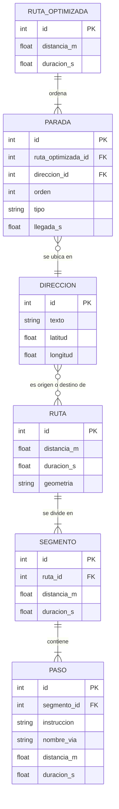
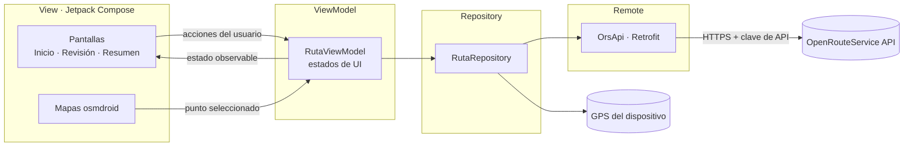

# 📍 RutaLista Inteligente

Aplicación Android para **domiciliarios independientes** que necesitan organizar y optimizar sus recorridos de entrega en el Área Metropolitana del Valle de Aburrá (Antioquia, Colombia).

**Programa:** Análisis y Desarrollo de Software (ADSO) – SENA
**Plataforma:** Android · **Lenguaje:** Kotlin

---

## 🔗 Enlaces del proyecto

| Recurso | Enlace |
|---|---|
| 🎨 Prototipo UI/UX (Google Stitch) | Pendiente de publicar |
| 🎥 Video de presentación (máx. 5 min) | Pendiente de grabar |
| 💻 Repositorio | https://github.com/miguel-montalvo1991/android-design-rutalista |

## Idea y API elegida

RutaLista ayuda a los domiciliarios independientes del Valle de Aburrá a reunir las direcciones de su jornada, ordenarlas y calcular un recorrido. La app consume **OpenRouteService (ORS)** para buscar direcciones, convertir coordenadas en direcciones, optimizar el orden de las paradas y calcular rutas.

### ¿Por qué una app móvil?

El domiciliario trabaja en la calle y necesita registrar ubicaciones desde el teléfono, usar el GPS, seleccionar puntos en un mapa y consultar el recorrido durante la jornada. La aplicación móvil reúne esas acciones en un flujo disponible desde el dispositivo.

## 📑 Índice

1. [Problema, objetivo e idea](#problema-objetivo-e-idea)
2. [Tecnologías y API](#tecnologías-y-api)
3. [Modelo de datos (ER)](#modelo-de-datos-er)
4. [Arquitectura](#arquitectura)
5. [Pantallas y flujo de navegación](#pantallas-y-flujo-de-navegación)
6. [Buenas prácticas](#buenas-prácticas)
7. [Evidencia del proyecto base (Hito 5)](#evidencia-del-proyecto-base-hito-5)
8. [Integrantes](#integrantes)

## Problema, objetivo e idea

Los domiciliarios independientes suelen organizar sus entregas manualmente con mensajes, notas o memoria. Esto consume tiempo, puede producir recorridos más largos y aumenta los costos de combustible y las demoras para los clientes.

**Objetivo general:** diseñar una aplicación móvil que permita gestionar ubicaciones y optimizar recorridos de entrega mediante servicios de geolocalización y cálculo de rutas.

**Objetivos específicos**

- Definir un punto de origen y varios destinos mediante búsqueda, selección en el mapa o GPS.
- Calcular la distancia y el tiempo estimado de un recorrido.
- Sugerir un orden para las paradas y permitir revisarlo manualmente.
- Mostrar un resumen de la jornada.

## Tecnologías y API

| Tecnología | Uso |
|---|---|
| Kotlin | Lenguaje de programación |
| Android Studio | Entorno de desarrollo |
| Jetpack Compose + Material 3 | Interfaces de usuario |
| MVVM | Organización de la aplicación |
| Retrofit + Gson | Consumo de servicios REST y conversión JSON |
| osmdroid (OpenStreetMap) | Selección de ubicaciones en el mapa |
| Google Play Services Location | Ubicación GPS |
| OpenRouteService (ORS) | Geocodificación, rutas y optimización |
| Mermaid | Diagramas de este README |

La API base es `https://api.openrouteservice.org`. La clave se configura como `ORS_API_KEY` en `local.properties`, archivo ignorado por Git; no se debe publicar.

| Servicio | Método y ruta | Uso |
|---|---|---|
| Geocodificación | `GET /geocode/search` | Buscar una dirección por texto y obtener coordenadas |
| Geocodificación inversa | `GET /geocode/reverse` | Obtener una dirección a partir de coordenadas |
| Direcciones | `POST /v2/directions/driving-car/json` | Calcular distancia, duración e instrucciones de ruta |
| Optimización | `POST /optimization` | Proponer un orden para los destinos |

**Cuatro recursos principales:** Dirección, Ruta, Ruta optimizada y Parada. Segmento y Paso describen partes de la respuesta de Ruta; no son recursos principales independientes de la API.

## Modelo de datos (ER)

El diagrama representa las relaciones del modelo conceptual. Los identificadores son claves del modelo para expresar las relaciones; ORS no entrega necesariamente identificadores persistentes para todos los objetos anidados.

**Relaciones:** Ruta 1:N Segmento; Segmento 1:N Paso; Ruta optimizada 1:N Parada; Parada N:1 Dirección; y Dirección N:M Ruta, porque una dirección puede ser origen o destino de varias rutas. Los `id` de Segmento y Paso son índices locales del modelo cuando la respuesta de ORS no los proporciona.

## Arquitectura

La aplicación organiza la presentación con **MVVM**, un Repository para las operaciones de datos y una capa Remote para las llamadas HTTP.

- **View:** muestra el estado y envía las acciones de la persona usuaria.
- **ViewModel:** coordina operaciones y mantiene el estado de presentación.
- **Repository:** centraliza el acceso a ORS y a la ubicación del dispositivo, y adapta errores a mensajes para la interfaz.
- **Remote:** declara las llamadas HTTP mediante Retrofit.

## Pantallas y flujo de navegación

**Flujo implementado:** Inicio → Revisión de paradas → Resumen de jornada.

### 1. Inicio

- **Qué muestra:** búsqueda de direcciones, controles para elegir origen y destinos, lista de destinos y acceso a la selección en mapa o GPS.
- **Endpoints:** `GET /geocode/search` para buscar; `GET /geocode/reverse` al resolver coordenadas del mapa o GPS; `POST /optimization` para optimizar; `POST /v2/directions/driving-car/json` para calcular una ruta.
- **Acciones:** buscar y seleccionar direcciones, usar mapa o GPS, agregar destinos, optimizar su orden o calcular la ruta directa.
- **Dato que pasa a Revisión:** el origen y la lista de destinos seleccionados con sus coordenadas.

### 2. Revisión de paradas

- **Qué muestra:** destinos numerados con controles para subir, bajar o quitar cada parada. Si la lista está vacía, aparece “Aún no hay destinos”.
- **Endpoints:** ninguno; permite revisar y editar los datos que ya están en memoria.
- **Acciones:** reordenar, quitar un destino con confirmación, volver al inicio o continuar.
- **Dato que pasa a Resumen:** origen y destinos en el orden revisado.

### 3. Resumen de jornada

- **Qué muestra:** cantidad de destinos, distancia, duración y recorrido con origen y paradas numeradas. Si todavía no se calculó una ruta, indica cómo calcularla.
- **Endpoint:** no inicia una llamada nueva; presenta los datos de ruta calculados desde Inicio.
- **Acciones:** volver atrás o finalizar y regresar al inicio.

> El prototipo de Stitch y sus capturas se agregarán cuando estén publicados y disponibles.

## Buenas prácticas

| Práctica | Aplicación en RutaLista |
|---|---|
| Separación MVVM | `RutaScreen` → `RutaViewModel` → `RutaRepository` → `OrsApi` |
| Cliente HTTP | Retrofit con conversión JSON mediante Gson |
| Operaciones asíncronas | Métodos `suspend` en `OrsApi` |
| Estados de interfaz | Estados `Inicial`, `Cargando`, `Exito` y `Error` para búsqueda y ruta |
| Clave de API | Se configura en `local.properties` y se excluye del repositorio |
| Errores de red y API | El Repository adapta errores HTTP y de conexión a mensajes para la interfaz |
| Coil y Room/DataStore | No están incluidos en esta versión |

## Evidencia del proyecto base (Hito 5)

El proyecto Android se creó a partir de la plantilla **Empty Activity** con Kotlin y Jetpack Compose. El commit inicial documenta la base generada antes de incorporar funcionalidades de RutaLista:

[507beb9 — Primer commit de RutaLista](https://github.com/miguel-montalvo1991/android-design-rutalista/commit/507beb9ba63e4e05a4b3de865fef513750a0bb7f)

La captura de “Hello Android!” es opcional; si se agrega, debe comprobarse que el texto sea visible.

## Integrantes

| Nombre | Programa |
|---|---|
| Luis Miguel Montalvo | Análisis y Desarrollo de Software (ADSO), SENA |
| Diego Bermúdez | Análisis y Desarrollo de Software (ADSO), SENA |

---

*Proyecto académico del programa ADSO – SENA. Los datos de prueba son ficticios y ninguna clave se publica en el repositorio.*
