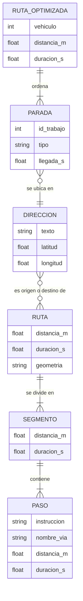
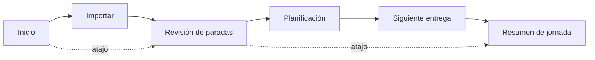

# 📍 RutaLista Inteligente

Aplicación Android para **domiciliarios independientes** que necesitan organizar y optimizar sus recorridos de entrega en el Área Metropolitana del Valle de Aburrá (Antioquia, Colombia).

**Programa:** Análisis y Desarrollo de Software (ADSO) – SENA
**Plataforma:** Android · **Lenguaje:** Kotlin

---

## 🔗 Enlaces del proyecto

| Recurso | Enlace |
|---|---|
| 🎨 Prototipo UI/UX (Google Stitch) | https://stitch.google.com/projects/10905825141307537811 |
| 🎥 Video de presentación (máx. 5 min) | `PEGAR_AQUI_EL_ENLACE_DEL_VIDEO` |
| 💻 Repositorio | https://github.com/miguel-montalvo1991/android-design-rutalista |

---

## 📑 Índice

1. [Descripción y objetivo](#1-descripción-y-objetivo)
2. [Problema que resuelve](#2-problema-que-resuelve)
3. [Tecnologías](#3-tecnologías)
4. [API que consumirá la app](#4-api-que-consumirá-la-app)
5. [Diagrama de datos (ER)](#5-diagrama-de-datos-er)
6. [Arquitectura](#6-arquitectura)
7. [Pantallas y flujo de navegación](#7-pantallas-y-flujo-de-navegación)
8. [Integrantes](#8-integrantes)

---

## 1. Descripción y objetivo

RutaLista ayuda a un domiciliario a **reunir sus destinos del día, ordenarlos de la forma más eficiente y recorrerlos**, sin tener que organizar las direcciones a mano.

**Objetivo general:** diseñar una aplicación móvil que permita gestionar ubicaciones y optimizar recorridos de entrega mediante servicios de geolocalización y cálculo de rutas.

**Objetivos específicos**

- Permitir definir un punto de origen y varios destinos por búsqueda de texto, selección en el mapa o GPS.
- Calcular la distancia y el tiempo estimado de un recorrido.
- Sugerir el mejor orden de las paradas para evitar devolverse.
- Mostrar un resumen de la jornada.

## 2. Problema que resuelve

Los domiciliarios independientes organizan sus entregas manualmente (mensajes, notas, memoria). Esto consume tiempo, genera recorridos innecesariamente largos y aumenta el costo de combustible y el tiempo de espera de los clientes.

## 3. Tecnologías

| Tecnología | Función |
|---|---|
| Kotlin | Lenguaje de programación |
| Android Studio | Entorno de desarrollo |
| Jetpack Compose + Material 3 | Interfaces |
| MVVM | Arquitectura |
| Retrofit + OkHttp | Consumo de la API REST |
| osmdroid (OpenStreetMap) | Mapas |
| Google Play Services Location | Ubicación GPS |
| OpenRouteService (ORS) | Geocodificación, rutas y optimización |
| Google Stitch | Diseño UI/UX y flujo de pantallas |
| Mermaid | Diagramas dentro de este README |

## 4. API que consumirá la app

Se consume **OpenRouteService** (`https://api.openrouteservice.org`).

| Servicio | Método y ruta | Para qué se usa |
|---|---|---|
| Geocodificación | `GET /geocode/search` | Convertir un texto en una dirección con coordenadas |
| Geocodificación inversa | `GET /geocode/reverse` | Convertir un punto del mapa o del GPS en una dirección |
| Direcciones | `POST /v2/directions/driving-car/json` | Calcular la ruta, distancia, duración e instrucciones |
| Optimización | `POST /optimization` | Calcular el mejor orden de las paradas |

La autenticación se hace con una **clave de API** que se guarda en `local.properties` y **nunca** se sube al repositorio.

### Recursos (entidades) que provienen de la API

| # | Recurso | Origen en la API |
|---|---|---|
| 1 | **Dirección** | Resultado de geocodificación (texto + coordenadas) |
| 2 | **Ruta** (con segmentos y pasos) | Respuesta de direcciones |
| 3 | **Ruta optimizada** | Respuesta de optimización |
| 4 | **Parada** | Pasos de la ruta optimizada (trabajos) |

## 5. Diagrama de datos (ER)

## 6. Arquitectura

La app usa **MVVM** con una capa **Repository** y una capa **Remote** para hablar con la API.

**Responsabilidades**

- **View:** solo muestra información y envía las acciones del usuario al ViewModel.
- **ViewModel:** guarda el estado de la pantalla (cargando, éxito, error) y coordina las operaciones.
- **Repository:** centraliza el acceso a la API y al GPS y traduce los errores a mensajes legibles.
- **Remote:** define las llamadas HTTP.

## 7. Pantallas y flujo de navegación

> 🎨 Diseño completo y navegable en **Google Stitch**: `PEGAR_AQUI_EL_ENLACE_DE_STITCH`

| # | Pantalla | Qué hace |
|---|---|---|
| 1 | **Inicio** | Buscar direcciones, elegir origen y destinos (texto, mapa o GPS), calcular la ruta y optimizar el orden |
| 2 | **Importar** | Cargar pedidos del día *(planificada)* |
| 3 | **Revisión de paradas** | Reordenar las paradas con flechas o quitar destinos |
| 4 | **Planificación** | Confirmar el orden y la hora de cada parada *(planificada)* |
| 5 | **Siguiente entrega** | Mostrar la próxima parada del recorrido *(planificada)* |
| 6 | **Resumen de jornada** | Ver cómo quedó el recorrido del día |

## 8. Integrantes

| Nombre 
|---|---|
| Luis Miguel Montalvo 
| Diego Bermúdez 

---

*Proyecto académico del programa ADSO – SENA. Los datos de prueba son ficticios y ninguna clave se publica en el repositorio.*
